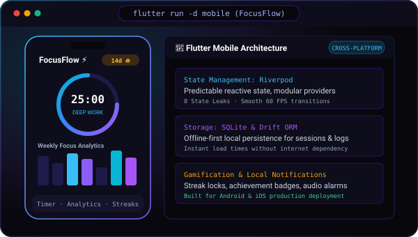

  
  
  
  
  
  

Mobile Application & Full Stack Developer (**Flutter · Android · Node.js · React · PostgreSQL · AWS**) and final-year B.Tech IT student at Anna University, Chennai. Co-founder of **Keyptu Studio**. I build and deploy production-grade software end-to-end — **from cross-platform mobile apps with reactive state and offline storage to autonomous AI payment recovery agents and real-time transit fleet telematics.** Open to full-time Mobile Developer (Flutter/Android) & Software Engineer (SDE-1 / Full Stack) roles.

### 🟢 Spotlight Systems

<table>
  <tr>
    <td width="50%" valign="top">
      
       <b><a href="https://github.com/nik1062/studytrackerapp">FocusFlow — Study Productivity Mobile App</a></b>
       Cross-platform mobile app designed to help users track deep study sessions and build daily habits. Features a configurable Pomodoro timer, weekly focus analytics with custom charts, daily streak gamification, and local notifications. Built with offline-first local persistence.
       Flutter · Dart · Riverpod · SQLite / Drift · Android · iOS
    </td>
    <td width="50%" valign="top">
      
       <b><a href="https://github.com/nik1062">SABAS — Bus Transit Automation &amp; Live Tracking</a></b>
       🏆 <b>First Prize Winner, NEURA '25 AI Hackathon (out of 25 teams).</b> Real-time fleet telematics system that keeps students and parents informed of bus GPS locations and security. Dispatches automated geofence alerts 10 minutes before the bus reaches the designated pickup point or destination. Aligned with UN SDG-4.
       Flutter · Dart · Node.js · WebSockets · Google Maps SDK · Cloud API
    </td>
  </tr>
  <tr>
    <td width="50%" valign="top">
      
       <b><a href="https://github.com/nik1062/RecoverForge">RecoverForge — AI Payment Recovery Agent</a></b>
       Autonomous agent built for the Razorpay AI Buildathon (Track 3). Ingests <code>payment.failed</code> webhooks, validates HMAC-SHA256 signatures, classifies root causes via GPT-4o-mini (with rule fallback), creates 48-hr Razorpay payment links, and executes an automated follow-up sequence (+1, +3, +7 days) with atomic lock guards.
       Node.js · Express · React · MongoDB · Razorpay · OpenAI · Docker · AWS EC2
    </td>
    <td width="50%" valign="top">
      
       <b><a href="https://github.com/nik1062/MediSync-POS">MediSync (ClinicOS) — Patient Mobile App &amp; POS</a></b>
       Unified healthcare operations platform. Combines a Flutter patient mobile app (Riverpod) with a React clinic dashboard powered by an Express and PostgreSQL backend. Features a real-time live OPD queue over Socket.io, dual-token JWT auth (access + refresh), doctor consultation logs, and a complete POS billing lifecycle.
       Flutter · Dart · Riverpod · Node.js · PostgreSQL · Sequelize · Socket.io
    </td>
  </tr>
</table>

### 🟠 More Projects & Client Work

| Project | Description | Stack |
|---|---|---|
| **[ColdMailForge](https://github.com/nik1062/ColdMailForge)** | AI-powered cold email SaaS platform — OTP verification, dynamic credit wallet with Razorpay checkout hooks, and context-enriched GPT email generation. | *React, Node.js, MongoDB, Razorpay* |
| **[CodeMeet AI](https://github.com/nik1062)** | Collaborative technical interview platform with multiplayer Monaco code editor (Yjs CRDT), LiveKit WebRTC video grid, and automated AI grading. | *Node.js, React, Yjs, LiveKit, Zustand* |
| **[Vayu](https://github.com/nik1062/vayu)** | Open-source developer tool with a native C++ load-testing engine — Postman-style requests + k6-level stress tests in one unified desktop app. | *C++, TypeScript, Electron* |
| **[FridgeFriend](https://github.com/nik1062)** | Grocery & pantry management mobile app — barcode scanning, smart expiry date tracking, and automated notification reminders to prevent food waste. | *Flutter, Dart, Firebase, Android* |
| **[RESTROPro](https://github.com/nik1062/Resturant_POS-system)** | Multi-tenant restaurant and cafe POS — role-based access (admin vs staff), live table ordering, kitchen ticket dispatch, inventory management, and sales reports. | *React, Node.js, Express, MySQL* |
| **[Metro Mirchi 2.0](https://github.com/nik1062/metro2.O)** | Client project — Production restaurant website with responsive layouts, interactive menus, and fast load times. | *React, TypeScript, Tailwind CSS* |

---

### 🧰 Tech Stack

#### 📱 Mobile & Cross-Platform Development

#### 💻 Programming Languages

#### 🌐 Frontend Development

#### ⚡ Backend, Real-Time & Integrations

#### 🗄️ Databases & ORMs

#### ☁️ Cloud, DevOps & Tools

#### 🤖 AI & Automation

---

### 📈 Shipping Every Week

<picture>
  <source media="(prefers-color-scheme: dark)" srcset="https://raw.githubusercontent.com/nik1062/nik1062/output/snake-dark.svg">
  <source media="(prefers-color-scheme: light)" srcset="https://raw.githubusercontent.com/nik1062/nik1062/output/snake-light.svg">
  
</picture>

🏆 First Prize, NEURA '25 AI Hackathon (out of 25 teams) · Team Leader, IBM NM Hackathon · Co-Founder, Keyptu Studio · Front-End Web Dev Intern, VaultofCodes.in · B.Tech IT, Anna University, Chennai (CGPA 8.5/10, Class of 2027)
