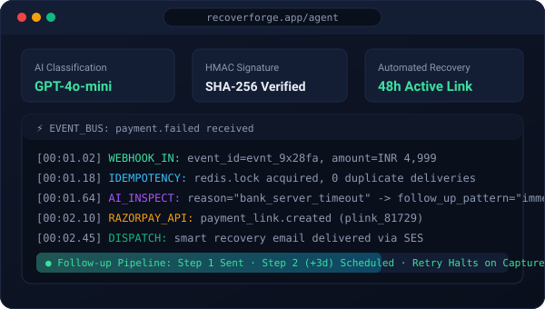
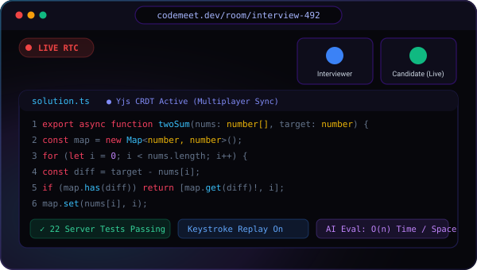
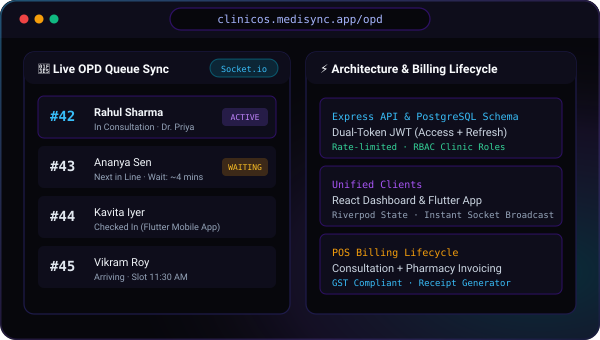
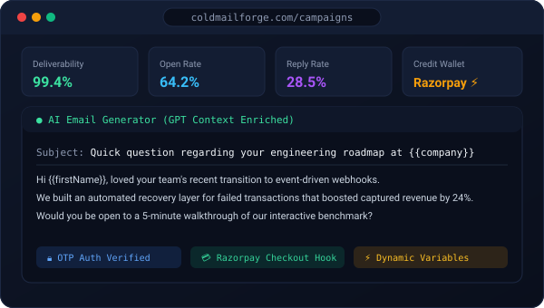

  
  
  
  
  

Full stack developer (**Node.js · React · PostgreSQL · AWS**) and final-year B.Tech IT student at Anna University, Chennai. Co-founder of **Keyptu Studio**. I design and ship high-reliability software end to end — **from autonomous AI recovery agents to real-time collaborative platforms and multi-tenant POS systems.** Open to full-time Software Engineer / SDE-1 / Full Stack roles.

### 🟢 Featured Systems

<table>
  <tr>
    <td width="50%" valign="top">
      
       <b><a href="https://github.com/nik1062/RecoverForge">RecoverForge</a></b> — autonomous agent for failed Razorpay payments (Razorpay AI Buildathon Track 3). Captures <code>payment.failed</code> webhooks, verifies HMAC-SHA256 signatures, classifies root causes via GPT-4o-mini, issues 48-hr recovery payment links, and manages a fraud-safe follow-up pipeline (+1, +3, +7 days) via node-cron with atomic locks.
       Node.js · Express · React · MongoDB · Razorpay · OpenAI · Docker · AWS EC2
    </td>
    <td width="50%" valign="top">
      
       <b><a href="https://github.com/nik1062">CodeMeet AI</a></b> — collaborative technical interview platform featuring a multiplayer Monaco code editor with CRDT sync (Yjs), WebRTC video grid for 2 to 6+ participants (LiveKit), in-browser code execution, LLM automated grading, keystroke replay, and paste-burst plagiarism detection.
       Node.js · React · Yjs · WebSockets · LiveKit (WebRTC) · Zustand · Zod · Jest
    </td>
  </tr>
  <tr>
    <td width="50%" valign="top">
      
       <b><a href="https://github.com/nik1062/MediSync-POS">MediSync (ClinicOS)</a></b> — clinic management and POS platform. Unified Express backend serving a React clinic dashboard and a Flutter patient app, featuring a real-time live queue over Socket.io, dual-token JWT auth (access + refresh), rate limiting, and an end-to-end POS billing lifecycle.
       Node.js · PostgreSQL · Sequelize · Socket.io · React · Flutter (Riverpod)
    </td>
    <td width="50%" valign="top">
      
       <b><a href="https://github.com/nik1062/ColdMailForge">ColdMailForge</a></b> — AI-powered cold outreach SaaS. Full authentication flow with OTP verification, dynamic credit wallet with Razorpay checkout hooks, automated campaign dispatcher, and context-enriched GPT email generation.
       React · Node.js · Express · MongoDB · Razorpay · Tailwind CSS
    </td>
  </tr>
</table>

### 🟠 Building Now & Open Source

| Project | Description | Stack |
|---|---|---|
| **[Vayu](https://github.com/nik1062/vayu)** | Open-source API client equipped with a native C++ load-testing engine — Postman-style REST requests + k6-level stress tests in one unified local client. | *C++, TypeScript, Electron* |
| **[RESTROPro](https://github.com/nik1062/Resturant_POS-system)** | Multi-tenant restaurant and cafe POS — role-based access (admin vs staff), live table ordering, kitchen ticket dispatch, inventory management, and sales reports. | *React, Node.js, Express, MySQL* |
| **[VedaAI](https://github.com/nik1062/VEDAAI)** | Intelligent educational tool automating assessment generation by parsing source PDFs and documents into structured tests with real-time updates. | *Python, React, FastAPI, LLMs* |
| **[Metro Mirchi 2.0](https://github.com/nik1062/metro2.O)** | Production client restaurant website built with modern responsive layouts and fluid interactions. | *React, TypeScript, Tailwind CSS* |

### 🧰 Stack

                   

### 📈 Shipping every week

<picture>
  <source media="(prefers-color-scheme: dark)" srcset="https://raw.githubusercontent.com/nik1062/nik1062/output/snake-dark.svg">
  <source media="(prefers-color-scheme: light)" srcset="https://raw.githubusercontent.com/nik1062/nik1062/output/snake-light.svg">
  
</picture>

🏆 First Prize, NEURA '25 AI Hackathon (out of 25 teams) · Team Leader, IBM NM Hackathon · Co-Founder, Keyptu Studio · Front-End Web Dev Intern, VaultofCodes.in · B.Tech IT, Anna University, Chennai (CGPA 8.0/10, Class of 2027)
